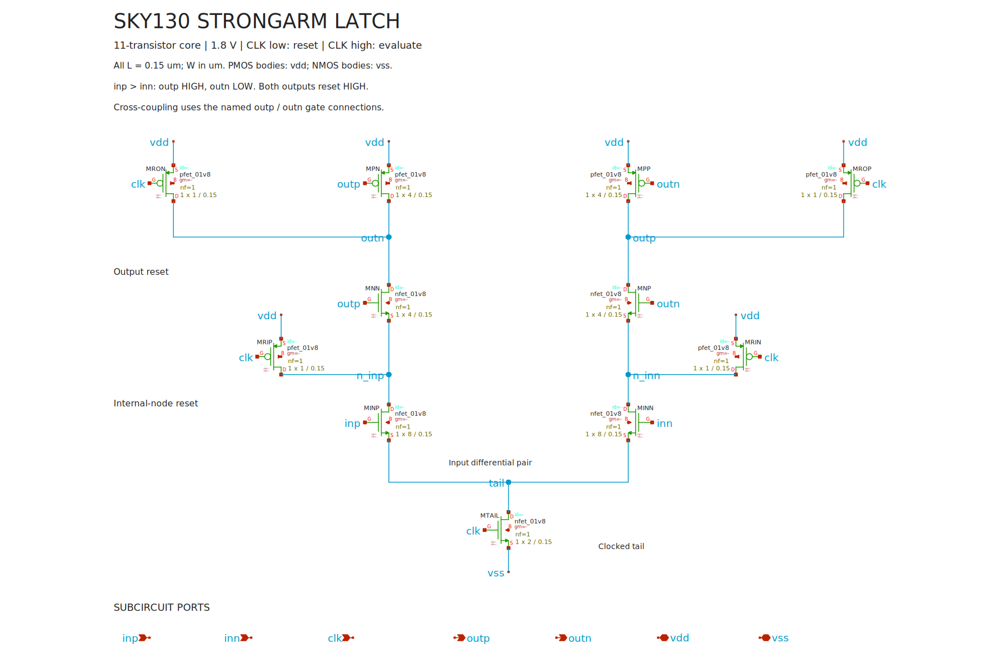

# StrongArm agent-in-the-simulation experiment

An actual AI model chooses experiments while an ngspice simulation is running. At each clock-cycle boundary, the simulator parks, the model reads the measured outputs and chooses the next differential input, and the same transient resumes. Every model proposal, brief explanation, accepted action and observation is logged. Replaying the recorded actions makes no model calls.

The circuit is an 11-transistor StrongArm latch using SKY130 1.8 V devices. A +43 mV voltage source in series with its positive input models a fixed offset. The model is **not told that value** or given the internal input voltages. It must learn the external decision threshold from measurements.

**The live AI command has no scripted stimulus policy.** Python checks bounds, validates evidence references, translates units and calls the simulator. A separate `recorded` command reuses decisions from the original demonstration and is explicitly labeled as having no fresh inference.

**[Explore the recorded experiment online](https://www.jasonjacobs.net/strongarm-agent-sim/)**: measured waveforms, a stimulus stem plot and expandable model responses. You can also open [docs/index.html](docs/index.html) locally; it works offline with no setup. See [GitHub Pages instructions](docs/pages.md) to publish your own copy from the repository's `/docs` folder.



## Requirements

- Python **3.11+** on Linux or macOS. Windows users should run the whole project in a Linux/WSL environment; native Windows pipe handling is not supported.
- The **ngspice executable and shared library** (`libngspice.so` on Linux, `libngspice.dylib` on macOS). A CLI-only installation is insufficient. This project uses `ngSpice_Init`, `ngSpice_Init_Sync` and external voltage-source callbacks. [Shared ngspice documentation](https://ngspice.sourceforge.io/shared.html).
- An installed **ngspice-compatible SKY130A PDK**, including the complete include tree rooted at `libs.tech/ngspice/sky130.lib.spice`. An [open_pdks installation](https://github.com/fossi-foundation/open-pdks) is the tested format. PDK files are not bundled or downloaded by setup.
- For fresh AI decisions: an authenticated **Codex CLI** with access to a model you select. The adapter was originally exercised with Codex CLI 0.163.0 and GPT-6 Astra; model access is account-dependent. `doctor --ai` checks required CLI options. [Official Codex installation and authentication documentation](https://learn.chatgpt.com/docs/codex/cli).
- Optional: Matplotlib for PNG plots; Xschem plus the SKY130 symbols for editing the schematic. Neither is required for simulation, logs, HTML reports or replay.

The core runtime uses the Python standard library. No API key is stored in this repository. See [installation details and a container example](docs/setup.md).

## Quick start

Clone or unpack this repository, then enter its directory. Substitute paths for **your** machine:

```sh
./setup.sh \
  --sky130-lib /path/to/sky130A/libs.tech/ngspice/sky130.lib.spice \
  --ngspice /path/to/bin/ngspice \
  --ngspice-library /path/to/lib/libngspice.so \
  --codex /path/to/bin/codex \
  --model YOUR_AVAILABLE_CODEX_MODEL

./run.sh doctor
./run.sh smoke
```

For macOS, pass the `.dylib` shared library instead. `--codex` and `--model` can be omitted when only running smoke tests, the recording or replay. Setup searches `PATH` for executables and accepts `SKY130_MODEL_LIB`, `PDK_ROOT` and `NGSPICE_LIBRARY` as discovery hints. Use `PYTHON_BIN=/path/to/python3 ./setup.sh ...` to select Python.

Setup writes `.local/config.json` and `.local/env.sh`, checks the library ABI and every PDK include, and does not change shell startup files. The run wrapper loads these settings automatically. Rerun setup after relocating the checkout. Local configuration and run logs are gitignored.

### Recreate the recorded demonstration without model calls

```sh
./run.sh recorded --output runs/recorded-demo
```

This executes the original 12 AI-chosen stimuli against your simulator, checks their measured decision polarities, then repeats the actions in another worker and requires identical observations and accepted samples. It is useful for verifying an installation before spending model usage. It does **not** claim that a model is currently making the choices.

### Run the actual agent

Authenticate Codex using its normal login flow, then:

```sh
codex login
./run.sh doctor --ai

# Inspect the initial prompt locally; zero model calls:
./run.sh ai --prepare-only --output runs/preflight

# Sends the documented observations to the configured OpenAI/Codex service:
./run.sh ai --output runs/live-demo
```

The default budget is 12 experiments and at most 16 model calls, including validation retries and a final stop response. The model chooses every input, including the first. Its prompt targets a 0.5 mV observed bracket and leaves strategy selection to the model. You can override `--model`, `--max-trials` and `--max-model-calls`; increasing trials also requires a sufficient model-call budget. `./run.sh ai --help` lists options. No fallback script chooses a voltage if the model fails.

The model receives a circuit description, external stimulus/output measurements, sampled waveform excerpts and its own decision history. The injected offset, internal input voltages, netlist, PDK files, prior recorded results and credentials are excluded. Calls use a separate temporary directory with shell, app and plugin tools disabled. Codex authentication remains in the user's normal credential store. **The AI command uses your account and may incur model charges.** Setup, doctor, smoke, recorded runs and replay make no inference calls.

## Results, explanations and replay

A completed AI run writes:

| File | Contents |
| --- | --- |
| `agent-loop.html` | Self-contained viewer: step through model choices, explanations and measured results |
| `report.md` | Readable experiment journal |
| `decisions.jsonl` | Model contexts, proposals, validation, commitments and results |
| `call-*/` | Exact prompt, schema, original response, model runtime metadata and inference duration |
| `live/events.jsonl` | Committed simulator requests and observations |
| `live/waveforms.jsonl` | All accepted timepoints and saved voltages/currents |
| `live/manifest.json` | Circuit, worker, PDK and shared-library hashes, numerical settings and platform |
| `replay/` | Automatically verified action replay |
| `verification.json`, `provenance-audit.json` | Replay and model-to-stimulus checks |

Open `runs/live-demo/agent-loop.html` directly in a browser. It is a local saved-result viewer, not a live control interface. If Matplotlib is available, a PNG plot is also generated; `./setup.sh ... --with-plots` creates a project-local virtual environment and installs the optional dependencies.

```sh
# Output directories must be new; existing evidence is never overwritten.
./run.sh replay runs/live-demo/live --output runs/replay-again
./run.sh audit runs/live-demo
./run.sh report runs/live-demo
```

Replay uses saved actions, not fresh model inference. Exact numerical reproduction is checked in the same environment, including library, code, model-content hashes and solver settings. A different ngspice/PDK build may produce different timepoints. The supplied recording validates **decision polarities** across installations, then validates exact replay against a new baseline produced locally. It does not assert that another platform will reproduce the historical sample count.

## What the original experiment showed

The recorded demonstration on November 17, 2026 used 13 GPT-6 Astra calls: 12 stimulus choices and a final stop. It found an external threshold bracket of **[−43.359375, −42.968750] mV**. It used the final experiment to repeat the upper endpoint after the opposite preceding decision. The original live/replay pair matched **48,603 accepted samples**. These are historical results; a fresh model run may choose a different strategy or stop earlier.

The supplied [recording](examples/recorded-session.json) retains numeric proposals and explanations, expected decisions and the original result summary. Host paths, session identifiers and full CLI logs are omitted. It is a portable reproduction fixture, not a cryptographic attestation of the original service calls.

The [web explainer](docs/index.html) includes a separate sanitized export of the original run: all accepted waveform samples, public measurements, model responses and inference durations. Visitors can select any of the 12 stimuli or the final stop, zoom into a clock cycle or decision edge, and download the displayed dataset. No simulation or model service runs in the page.

## Architecture and scope

See [the API and synchronization design](docs/architecture.md). This is a nominal TT/27 °C, noiseless schematic demonstration, with ideal sources and 10 fF output loads. The model controls differential amplitude; clock/reset/measurement timing is fixed by the API. A series offset source raises the actual input-pair common mode by 21.5 mV. Random mismatch, offset distributions, ISF, kickback into realistic source impedances and layout extraction are outside this experiment.

The schematic is provided in `schematics/`; `./run.sh schematic` opens it when Xschem is configured. The checked-in `circuits/strongarm.spice` is the simulation source and preserves the verified schematic's device connections and sizes. Editing the schematic does not silently regenerate that netlist.

## Tests and distribution

```sh
python3 -m unittest discover -s tests -p 'test_*.py'
./run.sh smoke
./run.sh recorded

# From a clean, committed checkout: creates source archives and SHA256SUMS.
python3 scripts/make_release.py
```

See [validation details](docs/validation.md). [MIT licensed](LICENSE). [Third-party attribution](THIRD_PARTY.md) describes the circuit sizing reference and external tools. Neither PDK models nor credentials are distributed. This repository is independently usable; it has no dependency on its original parent workspace or named Docker container.
