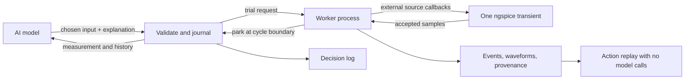

# Agent API, synchronization, and replay



## Worker protocol

The controller owns one subprocess, which owns one `libngspice` instance. Standard input and output carry newline-delimited JSON. ngspice diagnostics go to files rather than contaminating the protocol. The first response is an observation parked at time zero. Supported methods:

```json
{"method":"observe"}
{"method":"trial","request_id":"ai-001","based_on_epoch":0,"diff_V":-0.1}
{"method":"close"}
```

Every response is `{"ok":true,"result":...}` or `{"ok":false,"error":"..."}`. A trial returns epoch/time, accepted-point count and a measured classification (`0`, `1` or null), rail voltages, precharge minimum and sustained decision delay. The raw worker also reports the injected source/internal differential for local debugging; the model-facing allowlist removes them.

The agent response schema adds an explanation, expected observation, evidence epochs and an optional bracket made from previously measured opposite decisions. The host rejects unsupported/stale/nonfinite/out-of-bounds proposals. It does **not** substitute a value. Model proposals are restricted to ±100 mV; the worker's general API bound is ±200 mV. Identical request-ID retries return the original response; conflicting reuse and stale epochs fail without changing the schedule.

## Simulation-time schedule

Each accepted trial consumes one 20 ns cycle. The new input differential follows a 100 ps smoothstep from cycle start +2 ns to +2.1 ns, during reset. The clock begins rising at +10 ns. Precharge is checked during +8 to +9 ns; actual applied input during +9.5 to +10 ns. A decision must sustain complementary 90%/10% output rails during +13 to +19 ns. No unresolved result is interpreted as a sign.

`GetSyncData(loc=0)` parks the solver on the host's cycle barrier. Inference runs outside solver callbacks. The controller verifies that the observation is identical before and after each model call. Scheduling only future ramps while parked prevents wall-clock races. Source callbacks are pure functions of simulation time and the committed schedule, so Newton retries do not advance or mutate stimulus state. Proposed solver steps are shortened at ramp endpoints and the next barrier; the controller never increases a retry step.

The circuit is never reloaded/reset between model choices. Its clock drives physical precharge; capacitor and transistor states persist throughout the transient. The shutdown path wakes a parked callback before requesting `bg_halt`.

## Evidence and determinism

The controller journals the model context, original proposal, validation outcome, exact request and returned result. It flushes/fsyncs commitments before allowing the next trial. The worker independently journals requests before changing the schedule and stores every accepted sample. Protocol recovery after an interrupted process is not implemented; a complete committed session can be replayed in a new process.

Each manifest hashes the shared library, worker/config/fixture code, canonical generated netlist and full recursive PDK include closure. Circuit hashing normalizes the configured PDK root path; model graph keys are relative, so simply relocating an equivalent installation does not change content identity. Solver, Python/platform information and numerical settings also participate in provenance comparison.

Replay applies committed worker requests in order and compares every observation and accepted timepoint/value through the final barrier. It makes no model call and does not recompute a policy. The `recorded` reproduction command intentionally starts a new numerical baseline from portable historical actions; it compares decision outcomes to the recording and then checks exact replay locally.

Bitwise reproducibility across different solver builds/platforms is not promised. Model nondeterminism is independent: fresh inference can choose different experiments, even if the circuit is unchanged.
